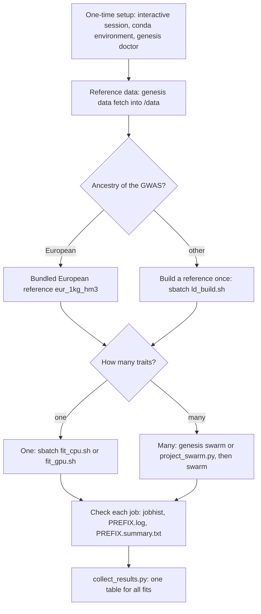

# GENESIS on NIH Biowulf

A practical guide to running [GENESIS](https://github.com/jeyabbalas/GENESIS) on
[Biowulf](https://hpc.nih.gov), the NIH HPC cluster: installing it, fetching the LD
reference, analysing one trait on CPUs or on a GPU, analysing many traits with `swarm`,
and a complete worked example for a project with several ancestries and several disease
subtypes. What the method estimates, how to read its output and every command-line
option are covered in the [main documentation](https://jeyabbalas.github.io/GENESIS/);
this page adds only what is specific to the cluster.

> **How far this guide has been tested.** GENESIS and every script in
> [`examples/biowulf`][examples] were developed and tested on a laptop, with Slurm's
> environment variables simulated. **Nothing on this page has been run on Biowulf by the
> developers**, and the GPU code has so far only been exercised through PyTorch on CPUs.
> Facts about the cluster come from hpc.nih.gov as of September 2026.
> [Section 9](#9-what-has-not-been-verified-on-biowulf) lists every unverified statement
> next to the command that checks it. Work through it on your first day.

> **If you use an AI coding assistant.** NIH HPC does not allow AI agents on the Biowulf
> login node or on Helix. An agent may only run inside an interactive session on a
> compute node, and you are responsible for what it does
> ([policy](https://hpc.nih.gov/policies/index.html#AI)). Submitting jobs stays with you.

**Contents**

1. [At a glance](#1-at-a-glance)
2. [One-time setup](#2-one-time-setup)
3. [Reference data](#3-reference-data)
4. [Running one analysis](#4-running-one-analysis)
5. [Using several CPUs and several GPUs](#5-using-several-cpus-and-several-gpus)
6. [Worked example: several ancestries, several subtypes](#6-worked-example-several-ancestries-several-subtypes)
7. [Monitoring, right-sizing and common failures](#7-monitoring-right-sizing-and-common-failures)
8. [Reproducibility](#8-reproducibility)
9. [What has not been verified on Biowulf](#9-what-has-not-been-verified-on-biowulf)
10. [Help and acknowledgement](#10-help-and-acknowledgement)

Every command block below starts with a comment saying where it runs:
`# on your computer`, `# on Biowulf (login node)` or
`# on a compute node (sinteractive session)`. Blocks without such a line show output or
file contents.

## 1. At a glance

| You want to | Run | Where | More |
|---|---|---|---|
| install GENESIS | `bash setup_env.sh` | compute node | [2](#2-one-time-setup) |
| check the installation | `genesis doctor --benchmark`, and `sbatch gpu_check.sh` for GPUs | compute node, login node | [2.5](#25-check-the-installation) |
| download the LD reference | `sbatch fetch_refdata.sh default,nullz` | login node | [3](#3-reference-data) |
| analyse one trait on CPUs | `sbatch fit_cpu.sh SUMSTATS OUT_PREFIX [options]` | login node | [4.2](#42-a-cpu-job) |
| analyse one trait on a GPU | `sbatch fit_gpu.sh SUMSTATS OUT_PREFIX [options]` | login node | [4.3](#43-a-gpu-job) |
| know how many CPUs to ask for, or whether a GPU pays | `genesis doctor --benchmark`, or `sbatch benchmark.sh` | compute node, login node | [5.1](#51-cpus-within-one-fit) |
| analyse many traits | `genesis swarm ...`, then the `swarm` command it prints | compute node, login node | [5.3](#53-many-fits-at-once-swarm) |
| analyse a whole project (ancestries x subtypes) | `python project_swarm.py PROJECT`, `swarm ...`, `python collect_results.py ...` | compute node, login node | [6](#6-worked-example-several-ancestries-several-subtypes) |
| build an LD reference for another ancestry | `sbatch ld_build.sh ...` | login node | [6.2](#62-an-ld-reference-for-each-ancestry) |
| see what a finished job really used | `jobhist JOBID` | login node | [7](#7-monitoring-right-sizing-and-common-failures) |

All scripts named here are in [`examples/biowulf`][examples].



**The short version**, for a first run with the bundled European reference:

```bash
# on Biowulf (login node)
sinteractive --cpus-per-task=4 --mem=20g --gres=lscratch:20 --time=2:00:00
```

```bash
# on a compute node (sinteractive session)
export TMPDIR=/lscratch/$SLURM_JOB_ID
module load mamba_install && mamba_install      # only if /data/$USER/conda does not exist yet; read 2.2 first
git clone https://github.com/jeyabbalas/GENESIS.git /data/$USER/GENESIS
bash /data/$USER/GENESIS/examples/biowulf/setup_env.sh
exit
```

```bash
# on Biowulf (login node)
S=/data/$USER/GENESIS/examples/biowulf
mkdir -p /data/$USER/proj/logs && cd /data/$USER/proj
sbatch --output=logs/%x-%j.out $S/fetch_refdata.sh default,nullz
sbatch --output=logs/%x-%j.out $S/fit_cpu.sh /data/$USER/proj/sumstats/trait.sumstats.tsv.gz /data/$USER/proj/results/trait --qq
```

Five habits that the scripts already follow, and that keep you out of trouble:

1. **No computing on the login node.** Installing, downloading and fitting happen in an
   interactive session or a batch job. The login node is for `sbatch`, `swarm` and
   looking at job status.
2. **Everything lives under `/data`.** The conda environment, the reference data, your
   inputs and your results go to `/data/$USER` (or a shared `/data/GROUP` directory).
   `/home` is 16 GB and is never enlarged. `/data` is not backed up: keep irreplaceable
   inputs somewhere else as well.
3. **Say how much you need.** A job without `--cpus-per-task`, `--mem` and `--time` gets
   2 CPUs, 4 GB and the partition's default walltime.
4. **Let GENESIS size itself.** It takes its thread count from `$SLURM_CPUS_PER_TASK` and
   its GPUs from what Slurm grants the job. Do not pass `--threads` in job scripts.
5. **Many traits means a swarm**, not a loop of `sbatch` calls.

## 2. One-time setup

Allow about half an hour. Everything in this section runs on a compute node.

### 2.1 Open an interactive session

```bash
# on your computer  (NIH network or VPN)
ssh username@biowulf.nih.gov
```

```bash
# on Biowulf (login node)
module load tmux && tmux new -s genesis     # optional: the session then survives a dropped connection
sinteractive --cpus-per-task=4 --mem=20g --gres=lscratch:20 --time=2:00:00
```

The prompt changes to a node name such as `cn1234`. The request is the size NIH uses for
conda installations; the default session (2 CPUs, 1.5 GB) is too small for one. An
interactive session ends when the login shell that started it ends, which is why `tmux`
helps (`tmux attach -t genesis` reconnects). You may hold at most two interactive
sessions at a time.

### 2.2 Install Miniforge under /data

Skip this if you already have a conda installation in `/data/$USER/conda`:

```bash
# on a compute node (sinteractive session)
ls -d /data/$USER/conda ~/bin/myconda 2>/dev/null
```

Otherwise install Miniforge with NIH's helper:

```bash
# on a compute node (sinteractive session)
export TMPDIR=/lscratch/$SLURM_JOB_ID
module load mamba_install
mamba_install
```

`mamba_install` puts Miniforge in `/data/$USER/conda` (several GB) and writes the
activation file `~/bin/myconda`. Know two things before you run it:

- By default it also **removes `conda init` blocks from your shell start-up files**.
  That is NIH's intent: an environment that activates at login can break logins and
  graphical sessions. `mamba_install --no-cleanup` leaves the files alone.
- Never run `conda init` on Biowulf, and never activate an environment in `~/.bashrc`.
  Activate per shell or per job, as shown below.

### 2.3 Create the environment

```bash
# on a compute node (sinteractive session)
git clone https://github.com/jeyabbalas/GENESIS.git /data/$USER/GENESIS    # also brings the job scripts
bash /data/$USER/GENESIS/examples/biowulf/setup_env.sh
```

[`setup_env.sh`][setup_env] refuses to run on the login node, creates an environment
called `genesis`, installs GENESIS into it and finishes with `genesis doctor`. Its
essential steps, if you prefer to type them:

```bash
# on a compute node (sinteractive session)
export TMPDIR=/lscratch/$SLURM_JOB_ID
source /data/$USER/conda/etc/profile.d/conda.sh
CONDA_OVERRIDE_CUDA=12.4 mamba create -y -n genesis -c conda-forge \
    python=3.12 numpy scipy pandas matplotlib threadpoolctl pip git 'pytorch=*=cuda*'
conda activate genesis
python -m pip install --no-cache-dir "genesis-gwas[gpu] @ git+https://github.com/jeyabbalas/GENESIS.git"
python -c 'import torch; print(torch.__version__, torch.version.cuda)'    # the second value must not be None
genesis doctor
```

Why it looks like this:

- **`CONDA_OVERRIDE_CUDA=12.4` and `'pytorch=*=cuda*'`.** A CPU node has no GPU driver,
  and without these two hints conda can quietly install a CPU-only PyTorch. The check on
  the line before `genesis doctor` catches that.
- **conda packages first, `pip` last.** NumPy, SciPy, pandas, Matplotlib and PyTorch come
  from conda-forge; `pip` then adds only GENESIS, which is pure Python and needs no
  compiler.
- **`--no-cache-dir`.** pip's cache would otherwise go to `~/.cache/pip`, inside the
  16 GB home quota.
- **`TMPDIR` on lscratch.** Package downloads and builds use temporary space; `/tmp` on a
  node is small and shared.

To use the environment in a later session:

```bash
# on a compute node (sinteractive session)
source /data/$USER/conda/etc/profile.d/conda.sh && conda activate genesis
```

Settings of `setup_env.sh` (environment variables): `ENV_NAME` (default `genesis`),
`CONDA_ROOT` (default `/data/$USER/conda`), `CUDA_VERSION` (default `12.4`), `CPU_ONLY=1`
(no PyTorch), and `GENESIS_SPEC`, which chooses what is installed. For a reproducible
installation pin a tag or commit, or install from the clone you just made:

```bash
# on a compute node (sinteractive session)
cd /data/$USER/GENESIS/examples/biowulf
GENESIS_SPEC=git+https://github.com/jeyabbalas/GENESIS.git@COMMIT_OR_TAG bash setup_env.sh
GENESIS_SPEC=file:///data/$USER/GENESIS ENV_NAME=genesis-dev bash setup_env.sh
```

### 2.4 Lighter alternatives

| Route | Use it when | How |
|---|---|---|
| conda environment with CUDA PyTorch (2.3) | you may want GPUs; recommended | `bash setup_env.sh` |
| conda environment without PyTorch | CPUs only; smaller and faster to create | `CPU_ONLY=1 bash setup_env.sh` |
| virtual environment on Biowulf's Python module | CPUs only, and you do not want conda | commands below |

```bash
# on a compute node (sinteractive session)
module load python/3.12
python -m venv /data/$USER/venvs/genesis
source /data/$USER/venvs/genesis/bin/activate
python -m pip install --no-cache-dir "genesis-gwas @ git+https://github.com/jeyabbalas/GENESIS.git"
genesis doctor
```

The job scripts activate the conda environment by default. For the virtual environment,
tell them how to activate when you submit, for example

```bash
# on Biowulf (login node)
GENESIS_ACTIVATE='module load python/3.12 && source /data/$USER/venvs/genesis/bin/activate' \
    sbatch $S/fit_cpu.sh SUMSTATS OUT_PREFIX
```

A virtual environment depends on the `python/3.12` module staying in place; a conda
environment is self-contained. None of the three routes has been run on Biowulf by the
developers ([section 9](#9-what-has-not-been-verified-on-biowulf)).

### 2.5 Check the installation

`genesis doctor` prints versions, the CPUs and GPUs the process may use, and then runs
the same likelihood, score and information computation on every available backend and
compares each with the single-threaded reference. With `--benchmark` it also times one
pass over a synthetic genome-wide data set on each of them. `setup_env.sh` ends with the
plain check. Run the benchmark once in a CPU session and once in a GPU job, and keep
both outputs: they are your record that the installation works, and the basis for
choosing resources ([5.1](#51-cpus-within-one-fit)).

```bash
# on a compute node (sinteractive session), environment active
genesis doctor --benchmark
```

Output from the development laptop with a 16-CPU Slurm allocation simulated (your
versions, platform and timings will differ):

```text
genesis-gwas 0.1.0
  python 3.12.13  numpy 2.5.5  scipy 1.18.1  torch 2.15.0
  platform: macOS-27.0.1-arm64-arm-64bit
  CPUs available to this process: 16 (machine: 18)  [Slurm job 12345678, --cpus-per-task=16]
  PyTorch CUDA build: none (CPU-only build); CUDA_VISIBLE_DEVICES=None
  GPUs: none visible

Self-test (three-component likelihood, scores and information on the packaged chr22 data):
  ok    numpy / cpu, 1 thread                        max rel. diff 0.0e+00   0.16 s
  ok    numpy / cpu, 16 thread(s)                    max rel. diff 0.0e+00   0.05 s
  ok    torch / cpu                                  max rel. diff 2.3e-14   0.08 s

All backends agree.

Benchmark: one pass over 1,000,000 synthetic SNPs, three-component model, c0 = 10
        numpy / cpu, 16 thread(s)                        373.6 ms per pass
        torch / cpu                                      709.5 ms per pass
  A default three-component fit needs on the order of 150 passes (two per EM iteration during the
  50-iteration warm-up, then a few Newton steps), a two-component fit one tenth of the work per pass.
```

What to look for on Biowulf:

- `CPUs available to this process` equals your `--cpus-per-task`, not the size of the
  node.
- In a CPU session, a GPU-capable environment still says `GPUs: none visible`, but the
  line above it must read `PyTorch CUDA build: 12.x`, not `none (CPU-only build)`.
- Every self-test line says `ok`. The command exits with status 1 otherwise, and such an
  installation must not be used.

The GPU can only be tested in a GPU job. [`gpu_check.sh`][gpu_check] is a 15-minute job
that prints `nvidia-smi`, runs `genesis doctor --benchmark` and fits the packaged
example on the GPU:

```bash
# on Biowulf (login node)
cd /data/$USER/proj && sbatch --output=logs/%x-%j.out $S/gpu_check.sh
```

Its output should list the device, compare it with the CPU, and time both. The lines
have this form (not captured on Biowulf; the layout is taken from the code):

```text
  PyTorch CUDA build: 12.4; CUDA_VISIBLE_DEVICES=0
  GPU 0: <model name> (<memory> GiB)
  ...
  ok    torch / cuda:0 (<model name>)                max rel. diff <below 1e-8>   <seconds> s
  ...
Benchmark: one pass over 1,000,000 synthetic SNPs, three-component model, c0 = 10
        numpy / cpu, 4 thread(s)                         <...> ms per pass
        torch / cpu                                      <...> ms per pass
        torch / cuda:0 (<model name>)                    <...> ms per pass
```

With two GPUs there is one line per device and one for `torch / all 2 GPUs`. Run the
check once for each GPU type you plan to use (`sbatch --constraint=gpua100 ...`,
`--constraint=gpuv100x`), and again after any change to the environment.

The demo fit at the end of that job uses a single chromosome. It warns that truncation
still matters at the ceiling `c0 = 20` and flags the three-component model as not
identified. Both are expected for so little data and say nothing about the installation.

## 3. Reference data

GENESIS needs an LD reference: for each SNP of a reference panel, how many SNPs it tags,
its LD score and its tagging neighbourhood. The European reference of the original
software (`eur_1kg_hm3`: 1000 Genomes Phase 3, 489 individuals, 1,070,777 HapMap3 SNPs,
GRCh37) is downloaded from the GitHub release
[`refdata-v1`](https://github.com/jeyabbalas/GENESIS/releases/tag/refdata-v1). Compute
nodes reach GitHub through the HPC web proxy, so the download works inside a job; do it
once, before any analysis.

```bash
# on Biowulf (login node)
cd /data/$USER/proj && sbatch --output=logs/%x-%j.out $S/fetch_refdata.sh default,nullz
```

or, if you are in a session anyway:

```bash
# on a compute node (sinteractive session), environment active
export GENESIS_DATA_DIR=/data/$USER/genesis-ref
genesis data fetch eur_1kg_hm3 --components default,nullz
genesis data list
genesis data verify $GENESIS_DATA_DIR/eur_1kg_hm3/1.0
```

`genesis data fetch` logs each file and prints the directory of the bundle;
`genesis data list` shows what is installed (output shortened):

```text
Downloading https://github.com/jeyabbalas/GENESIS/releases/download/refdata-v1/eur_1kg_hm3-1.0-snps.npz (11.1 MB)
Downloading https://github.com/jeyabbalas/GENESIS/releases/download/refdata-v1/eur_1kg_hm3-1.0-ld-w1000kb_r0.1.npz (21.4 MB)
Downloading https://github.com/jeyabbalas/GENESIS/releases/download/refdata-v1/eur_1kg_hm3-1.0-nullz-nullz_000-009.npy (21.4 MB)
...
Reference eur_1kg_hm3 is ready in /data/$USER/genesis-ref/eur_1kg_hm3/1.0
/data/$USER/genesis-ref/eur_1kg_hm3/1.0
```

```text
Data directory: /data/$USER/genesis-ref

eur_1kg_hm3 v1.0: 1000 Genomes Phase 3, LDSC EUR subset (n=489), HapMap3 SNPs with MAF>=0.05
  installed 12/22 files (247 of 504 MB) in /data/$USER/genesis-ref/eur_1kg_hm3/1.0
  LD configurations: w500kb_r0.05, w500kb_r0.1, w500kb_r0.2, w1000kb_r0.05, w1000kb_r0.1, w1000kb_r0.2, w2000kb_r0.05, w2000kb_r0.1, w2000kb_r0.2
   [ ] examples/height_giant2010.sumstats.tsv.gz            12.6 MB
   [ ] ld/w1000kb_r0.05.npz                                 27.0 MB
   [x] ld/w1000kb_r0.1.npz                                  21.4 MB
   ...
   [x] nullz/nullz_090-099.npy                              21.4 MB
   [ ] pairld/w1000kb_r0.1.npz                              69.5 MB
   [x] snps.npz                                             11.1 MB

Packaged (no download needed): mini_chr22
```

`genesis data verify` re-hashes every file and prints `ok`, `missing` or `corrupt` for
each; `missing` only means that the component was not fetched.

**What to fetch.**

| `--components` | Size | Needed for |
|---|---:|---|
| `default` | 32 MB | fitting with the standard LD settings (1 Mb window, r2 >= 0.1) |
| `nullz` | 214 MB | QQ plots with simulation envelopes (`--qq`) |
| `ld` | 196 MB | all nine LD settings, for sensitivity analyses (`--ld-window-kb`, `--ld-r2`) |
| `pairld` | 70 MB | simulating summary statistics with LD |
| `examples` | 13 MB | the GIANT height example used by the tutorial |
| `all` | 504 MB | everything |

Names can be combined with commas. `default,nullz` (247 MB) covers a standard analysis
with QQ plots.

**What you should know.**

- **Always set `GENESIS_DATA_DIR`.** Without it GENESIS uses `~/.cache/genesis-gwas`,
  which is in `/home`. The job scripts set it to `/data/$USER/genesis-ref` unless you
  export another value before submitting. `genesis fit --data-dir DIR` does the same for
  one command.
- **Integrity.** The SHA-256 checksum of every file ships inside the package. A download
  is written to a temporary name, verified and only then renamed, interrupted downloads
  resume, and a failed transfer is retried five times.
- **Swarms are safe, but fetch first anyway.** A missing component is fetched on demand,
  and a lock file ensures that when many jobs start at once only one of them downloads a
  given file while the others wait. Fetching beforehand avoids the waiting, keeps traffic
  through the shared proxy low, and makes a download problem show up in one job instead
  of fifty. If you use `--qq` in a swarm, fetch `nullz` first.
- **Sharing with your group.** Pass a group directory instead
  (`GENESIS_DATA_DIR=/data/GROUP/genesis-ref sbatch ... fetch_refdata.sh all`) and have
  everyone export the same `GENESIS_DATA_DIR`. The script sets `umask 027`, so the files
  are group-readable and not world-readable. Fetch `all` in that case: other members
  usually cannot write there, so nothing can be fetched on demand later.
- **Versions.** The reference is `eur_1kg_hm3` version 1.0, release tag `refdata-v1`.
  Every result file records the name, version and LD configuration it used
  ([section 8](#8-reproducibility)).
- **If the download fails in a job**, check that the proxy variables are set
  (`env | grep -i proxy` should list `https_proxy`). As a fallback, fetch on your own
  computer and copy the directory through Helix, NIH's data-transfer host:

  ```bash
  # on your computer
  genesis data fetch eur_1kg_hm3 --components all --dest ./genesis-ref
  scp -r ./genesis-ref username@helix.nih.gov:/data/username/
  ```

- **Other ancestries** need their own reference; see
  [6.2](#62-an-ld-reference-for-each-ancestry).

## 4. Running one analysis

### 4.1 The input file

One text file of GWAS summary statistics per trait, plain or gzipped, with a header. It
must provide a SNP identifier (or chromosome and position), a Z statistic (or effect and
standard error, or an odds ratio or effect with a P-value) and a sample size. Common
column names are recognised; anything else can be named with options such as `--snp`,
`--beta`, `--se`, `--n`. The [command-line reference][cli] and the [tutorial][tutorial]
describe all of them. Three points deserve attention in a consortium setting:

- **Case-control traits need the effective sample size**,
  `ncase x ncontrol / (ncase + ncontrol)`. Give `--n-cases` and `--n-controls` (column
  names or numbers) and GENESIS computes it. If your file already holds an effective N in
  the METAL or PGC convention, `4 / (1/ncase + 1/ncontrol)`, add `--n-scale 0.25`.
- **Identifiers must match the reference.** The bundled reference uses rsIDs. For files
  keyed by position use `--match-on position --build GRCh37` (or `GRCh38`).
- **Genome-wide files are much larger than what is used.** Only the SNPs in the LD
  reference enter the analysis, but `genesis fit` first reads the whole file, at about
  0.7 GB of memory per million rows. That is fine for one job
  ([4.5](#45-how-much-to-ask-for)); before fitting the same large file many times, shrink
  it once:

  ```bash
  # on a compute node (sinteractive session with --mem=4g or more), environment active
  export GENESIS_DATA_DIR=/data/$USER/genesis-ref
  python /data/$USER/GENESIS/examples/biowulf/subset_to_reference.py \
      /data/$USER/proj/raw/trait.genomewide.tsv.gz /data/$USER/proj/sumstats/trait.sumstats.tsv.gz
  ```

  [`subset_to_reference.py`][subset] keeps every column of the rows whose SNP is in the
  reference (`--reference DIR` for a custom one, `--chr/--pos/--build` to match by
  position) and reads in chunks. On the laptop it reduced a 10-million-row file to
  1.07 million rows in 70 seconds using 0.7 GB.

### 4.2 A CPU job

```bash
# on Biowulf (login node)
S=/data/$USER/GENESIS/examples/biowulf
mkdir -p /data/$USER/proj/logs && cd /data/$USER/proj
sbatch --output=logs/%x-%j.out $S/fit_cpu.sh \
    /data/$USER/proj/sumstats/trait.sumstats.tsv.gz /data/$USER/proj/results/trait --qq
```

`sbatch` prints the job ID and nothing else. The first two arguments are the input file
and the output prefix; everything after them is passed to `genesis fit` unchanged. A
case-control trait with a liability-scale heritability, for example:

```bash
# on Biowulf (login node)
sbatch --output=logs/%x-%j.out $S/fit_cpu.sh \
    /data/$USER/proj/sumstats/disease.sumstats.tsv.gz /data/$USER/proj/results/disease \
    --n-cases NCASE --n-controls NCONTROL --population-prevalence 0.01 --sample-prevalence 0.4 --qq
```

(`NCASE` and `NCONTROL` are column names here; the two prevalences are placeholders for
your trait's values.) The script, [`fit_cpu.sh`][fit_cpu], is short. Its working part:

```bash
#!/bin/bash
#SBATCH --job-name=genesis-fit
#SBATCH --cpus-per-task=16
#SBATCH --mem=8g
#SBATCH --time=00:30:00
set -euo pipefail
SUMSTATS=$1; OUT=$2; shift 2

set +u    # conda's activate scripts are not written for 'set -u'
eval "${GENESIS_ACTIVATE:-source /data/$USER/conda/etc/profile.d/conda.sh && conda activate genesis}"
set -u
export GENESIS_DATA_DIR=${GENESIS_DATA_DIR:-/data/$USER/genesis-ref}
export OMP_NUM_THREADS=1 OPENBLAS_NUM_THREADS=1 MKL_NUM_THREADS=1   # GENESIS runs its own thread pool

genesis fit "$SUMSTATS" --out "$OUT" --device cpu "$@"
```

Command-line flags override the `#SBATCH` lines, so you rarely need to edit the file:
`sbatch --cpus-per-task=8 --mem=16g --time=1:00:00 $S/fit_cpu.sh ...`. Jobs of four hours
or less may also name the `quick` partition, which has higher priority:
`sbatch --partition=quick,norm ...` (at most two partitions; the job runs in whichever
can start it first). The job needs no local scratch space: `genesis fit` writes only its
result files.

### 4.3 A GPU job

Read this before queueing for GPUs:

- **CPUs are the tested path, and they are fast.** A complete analysis took about a
  minute on 12 laptop threads ([4.5](#45-how-much-to-ask-for)). GPU nodes are scarcer
  than CPU nodes, so a GPU job can easily wait longer than a CPU job takes.
- **The GPU path is unverified on real hardware.** Run [`gpu_check.sh`][gpu_check]
  ([2.5](#25-check-the-installation)) before using a GPU for results. It runs
  `genesis doctor --benchmark`, which shows whether the GPU agrees with the CPUs and
  how much faster it is, if at all ([5.1](#51-cpus-within-one-fit)).
- **GENESIS computes in double precision.** A100, V100x, V100 and P100 are compute cards
  with fast double-precision arithmetic. The L40 is a graphics-class card: vendor data
  sheets give no double-precision rating for it, and it may be much slower here than its
  age suggests. Do not assume that the newest card is the fastest; benchmark. The oldest
  types (P100, V100) may also no longer be supported by a current PyTorch build;
  `gpu_check.sh` on that type tells you.

```bash
# on Biowulf (login node)
cd /data/$USER/proj
sbatch --output=logs/%x-%j.out $S/fit_gpu.sh \
    /data/$USER/proj/sumstats/trait.sumstats.tsv.gz /data/$USER/proj/results/trait_gpu
```

[`fit_gpu.sh`][fit_gpu] differs from the CPU script in its header and its last line:

```bash
#SBATCH --partition=gpu
#SBATCH --gres=gpu:1
#SBATCH --constraint="gpua100|gpuv100x"
#SBATCH --cpus-per-task=8
#SBATCH --mem=16g
#SBATCH --time=00:15:00
...
nvidia-smi --query-gpu=index,name,memory.total,memory.used --format=csv
genesis fit "$SUMSTATS" --out "$OUT" --device cuda "$@"
```

`--device cuda` means "all GPUs granted to this job" and stops with a clear error if
PyTorch cannot see one, instead of silently computing on the CPUs of a GPU node. What to
know about the request:

| GPU | How to request it | GPU memory | Most CPUs per GPU | Remark |
|---|---|---:|---:|---|
| A100 | `--gres=gpu:a100:1` | 80 GB | 16 | |
| V100x | `--gres=gpu:v100x:1` | 32 GB | 18 | |
| V100 | `--gres=gpu:v100:1` | 16 GB | 14 | old; check PyTorch support |
| P100 | `--gres=gpu:p100:1` | 16 GB | 14 | old; check PyTorch support |
| L40 | `--gres=gpu:1 --constraint=gpul40` | 48 GB | 42 | graphics-class; benchmark first |
| H200 | own partition `gpuh200`, at least 2 GPUs per job | 141 GB | 48 | scarce; not meant for jobs this small |

- **Stay within the CPUs-per-GPU limit.** Slurm accepts a job that asks for more, and the
  job then waits forever. The scripts ask for 8, which is within every limit.
- **Any type has enough memory.** The engine sizes its chunks from the free memory of
  the device, so a 16 GB card works like an 80 GB card, in more chunks.
- **Typed or untyped.** `--gres=gpu:a100:1` asks for one type. `--gres=gpu:1` with a
  quoted list, `--constraint="gpua100|gpuv100x"`, takes whichever is free first. The
  hardware changes: `freen | grep -E 'Partition|----|gpu'` on the login node shows the
  current types and how many are free.
- **One `--gres` only.** If you add local scratch, it goes in the same flag:
  `--gres=gpu:1,lscratch:10`. A second `--gres` replaces the first.

### 4.4 What comes back

For `--out results/trait`:

| File | Content |
|---|---|
| `trait.summary.txt` | the report: both models, estimates with standard errors, model comparison, QC table, warnings |
| `trait.estimates.tsv` | all estimates of all fitted models in long format (`model`, `selected`, `quantity`, `label`, `estimate`, `se`) |
| `trait.best.json` | the selected model, complete: estimates, covariance, diagnostics, settings, provenance |
| `trait.M2.json`, `trait.M3.json` | the two- and three-component fits |
| `trait.log` | the full log of the run |
| `trait.qq.png`, `trait.qq.tsv.gz` | with `--qq` |
| `trait.posterior.tsv.gz` | with `--posterior` |
| `trait.projection.tsv` | with `--project N1,N2,...` |

Slurm's own file (`logs/genesis-fit-JOBID.out` with the `--output` pattern above,
otherwise `slurm-JOBID.out` in the directory you submitted from) repeats the log and
adds anything Slurm has to say, such as an out-of-memory or time-limit message. A run
on the GIANT height example, started through `fit_cpu.sh` with 12 CPUs simulated on the
laptop, for a user called `jdoe` (shortened):

```text
host=...  job=1003  cpus=12  mem=8192MB
sumstats=/data/jdoe/proj/sumstats/height.sumstats.tsv.gz  out=/data/jdoe/proj/results/height  GENESIS_DATA_DIR=/data/jdoe/genesis-ref
genesis-gwas 0.1.0
19:50:42  Command: genesis fit /data/jdoe/proj/sumstats/height.sumstats.tsv.gz --out /data/jdoe/proj/results/height --device cpu --qq --posterior --project 2e5,5e5,1e6
19:50:42  Reference: eur_1kg_hm3 v1.0 (EUR, GRCh37, M = 1,070,777; window 1000 kb, r2 >= 0.1)
19:50:42  Read 1,037,172 rows from /data/jdoe/proj/sumstats/height.sumstats.tsv.gz (Z from Z; N from N)
19:50:43  QC: not in the LD reference (eur_1kg_hm3, matched on rsid)     removed     95,488,    941,684 remain
19:50:44  Prepared 941,684 SNPs for analysis (of 1,037,172 read)
19:50:44  Fitting the two-component model ...
19:50:44  Compute: numpy on CPU, 12 thread(s); 941,684 SNPs
...
19:50:50  Fitting the three-component model ...
19:50:50  Compute: numpy on CPU, 12 thread(s); 941,684 SNPs
19:51:37  Truncated prior mass 3.31e-06 exceeds 1e-06 at c0 = 10: re-solving with c0 = 14
...
GENESIS fit: M3 (three-component model)
  GWAS markers analysed (K)     : 941,684
  Reference-panel SNPs (M)      : 1,070,777
  Mean sample size              : 132,149.5
  Optimisation                  : converged after 51 EM iteration(s), c0 = 14; 3 Newton step(s)
  ...
  Derived quantity                                              Estimate          SE
  Number of susceptibility SNPs                                    10257        1623
  Total heritability                                             0.32592      0.0153
  ...
Model comparison by BIC (lower is better)
  Model               logLik       d_s               AIC               BIC       delta
  M2           3,950,388.003    93.379    -7,900,589.247    -7,899,524.616    1043.761
  M3           3,950,983.139   104.312    -7,901,757.653    -7,900,568.377       0.000  <- selected
19:51:48  Wrote /data/jdoe/proj/results/height.projection.tsv
19:52:03  Wrote /data/jdoe/proj/results/height.posterior.tsv.gz
19:52:21  Wrote /data/jdoe/proj/results/height.qq.png and /data/jdoe/proj/results/height.qq.tsv.gz (lambda_obs = 1.538, lambda_fit = 1.540; 100 simulations)
19:52:21  Selected model: M3. Results written to /data/jdoe/proj/results/height.*  (99.1 s)
```

The `Compute:` line is the one to check on the cluster: it must show the thread count
you asked for, or `torch:cuda:0 (<GPU model>, <memory> GiB)` in a GPU job. `genesis fit`
exits with status 0 on success, 1 on an error it explains in one `ERROR:` line, and 2
for a wrong command line, so a failed analysis is a `FAILED` job. What the numbers mean
is the subject of the [tutorial][tutorial] and the [output reference][outputs].

### 4.5 How much to ask for

**Memory.** The fit itself needs 2 to 4 GB for a HapMap3-sized analysis. What varies is
the input file, which is read whole before it is reduced to the reference SNPs.

| Input | `--mem` | Basis |
|---|---|---|
| up to about 1.5 million rows (HapMap3-sized, or filtered with `subset_to_reference.py`) | `8g` | measured peak 2.7 GB with both models, QQ plot and projections; 3.6 GB when per-SNP posteriors are written as well |
| about 5 million rows | `8g` | roughly 0.7 GB per million rows read, plus the above |
| about 10 million rows, read directly | `16g` | measured peak 7.2 GB |
| larger | filter first | the filter itself peaked at 0.7 GB |
| any of the above on a GPU | add about `8g` | PyTorch and the CUDA runtime also need host memory (estimate) |

A higher truncation level does not change this. The number of mixture terms per SNP
grows from 121 at `c0 = 10` to at most 441 at `c0 = 20` in the three-component model,
but the chunks shrink to match: on CPUs each thread works on about 2^18 values at a
time, and on a GPU the chunk is sized from the free memory of the device.

**Time.** Measured on one machine only, an Apple M5 Pro laptop that was busy with other
work: a complete analysis of the GIANT height GWAS (941,684 SNPs after QC) on 12
threads, with both models, model choice, projections, per-SNP posteriors and a QQ plot
with 100 simulations, took **63 seconds**. The original R/C++ package needed 90 seconds
for the two-component model and 1,349 seconds for the three-component model on the same
machine, without the QQ plot. The log in [4.4](#44-what-comes-back) is the same analysis
at a busier moment (99 seconds): about a minute of it is the three-component model, and
the posteriors and the QQ plot take 15 to 20 seconds each.

**No Biowulf CPU or GPU timing exists.** Biowulf nodes differ from each other and from a
laptop, so:

- start with `--time=00:30:00` per trait on 8 to 16 CPUs and `--time=00:15:00` on a GPU.
  Both are generous, and they are what `fit_cpu.sh` and `fit_gpu.sh` ask for;
- estimate before you run, with `genesis doctor --benchmark`
  ([5.1](#51-cpus-within-one-fit));
- after the first job, read `jobhist JOBID` and set `--time` to the measured runtime plus
  a quarter, and `--mem` to the measured peak plus a quarter
  ([section 7](#7-monitoring-right-sizing-and-common-failures));
- expect some traits to take longer. When the truncated prior mass at the solution
  exceeds `--tail-tol` (default 1e-6), GENESIS raises the truncation level `c0` and
  solves again, up to `--c0-max` (default 20; set it equal to `--c0` to fix the level).
  The work per SNP grows with `(c0 + 1)^2` in the three-component model. The height
  example is re-solved once at `c0 = 14`, as the log shows; highly polygenic traits in
  very large samples can take several times longer.

## 5. Using several CPUs and several GPUs

There are three different ways to use more hardware. They are not equally useful.

| Way | What it speeds up | Verdict |
|---|---|---|
| more threads in one fit | one trait | useful up to about 16 CPUs |
| several GPUs in one fit | one trait | rarely worth it at this problem size |
| many fits side by side (swarm) | a project | the efficient way to use many CPUs or GPUs |

### 5.1 CPUs within one fit

On CPUs, GENESIS splits the SNPs into small chunks and works on them with one thread per
allocated CPU. The thread count comes, in this order, from `GENESIS_NUM_THREADS`, from
`SLURM_CPUS_PER_TASK`, and from the CPUs the process is allowed to use, so it never sees
the whole node. Keep it that way: set `--cpus-per-task` and do not pass `--threads`.

How many CPUs are worth asking for is a question to measure, not to guess.
`genesis doctor --benchmark` times one pass over 1,000,000 synthetic SNPs with the
three-component model, on the CPUs of the allocation and on every GPU the job has.
[`benchmark.sh`][benchmark] wraps it in a job that also repeats the CPU measurement with
4, 8, 16 and 32 threads. Submit it once on CPUs and once with a GPU, and keep both
outputs:

```bash
# on Biowulf (login node)
cd /data/$USER/proj
sbatch --output=logs/%x-%j.out $S/benchmark.sh                               # 32 CPUs
sbatch --output=logs/%x-%j.out --partition=gpu --gres=gpu:a100:1 \
       --cpus-per-task=16 --mem=16g $S/benchmark.sh                          # 16 CPUs and one A100
```

Real output from the laptop, with 16 CPUs simulated on a busy machine (shortened):

```text
--- CPU threads: one pass over 1000000 synthetic SNPs, three-component model, c0 = 10
        numpy / cpu, 4 thread(s)                         548.9 ms per pass
        numpy / cpu, 8 thread(s)                         377.6 ms per pass

--- every backend and device of this job, with the full allocation (16 CPUs)
...
Benchmark: one pass over 1,000,000 synthetic SNPs, three-component model, c0 = 10
        numpy / cpu, 16 thread(s)                        353.7 ms per pass
        torch / cpu                                      595.5 ms per pass
```

How to use the numbers:

- **Threads.** On that laptop 8 threads were 1.5 times as fast as 4, and 16 hardly
  faster than 8; against a single thread the developers measured a speed-up of about 4.5
  at 6 threads and about 5 at 12 to 18. The machine has 6 fast and 12 slow cores, so the
  plateau may say more about the laptop than about GENESIS. On Biowulf a "CPU" is a
  hyperthread, two per physical core, which usually also means that 16 CPUs give less
  than twice the speed of 8. Until you have your own table, **use 8 to 16 CPUs per
  fit**; more are better spent on running more fits at once.
- **Time.** A default three-component fit needs on the order of 150 passes, and the
  two-component fit a tenth of the work per pass. At 0.35 seconds per pass and 0.94
  million SNPs that is about 50 seconds for the three-component model; the laptop took
  42 to 58 seconds in three runs. Scale by your number of SNPs after QC, in millions,
  and add about a minute for reading, QC, standard errors and output.
- **CPU or GPU.** In a GPU job the benchmark adds one line per GPU,
  `torch / cuda:0 (<model>)`, and with several GPUs one for `torch / all N GPUs`. Compare
  them with the `numpy / cpu` line of a CPU job that has the number of CPUs you would
  otherwise request. `torch / cpu` is the GPU code path run on CPUs. It exists for
  testing and is slower than the NumPy backend; do not use it for work.

### 5.2 Several GPUs within one fit

`--device cuda` uses every GPU the job was granted: the SNPs are divided into one
contiguous block per GPU, each GPU processes its block, and the partial sums are added on
the host in a fixed order. [`fit_multigpu.sh`][fit_multigpu] requests two A100s on one
node (`--gres=gpu:a100:2`) and is otherwise identical to `fit_gpu.sh`.

Honest guidance: **do not expect much.** One fit of about a million SNPs should be a
small problem for a single GPU, and reading the file, QC, matching and writing output do
not use the GPU at all. Splitting the GPU part in two cannot shorten those. Several GPUs
per fit can pay off only when the GPU part dominates: many more SNPs than HapMap3, or a
large truncation level (`--c0 20` and above). The multi-GPU path has not been run on
real hardware by the developers. Before adopting it, run `genesis doctor --benchmark`
in a job with two GPUs: it prints `torch / cuda:0`, `torch / cuda:1` and
`torch / all 2 GPUs` side by side, which is the comparison you need, without touching
your data. After a real run, check how busy the GPUs were:

```bash
# on Biowulf (login node)
dashboard_cli jobs --jobid JOBID --fields jobid,state,elapsed_time,gpus,gpu_avg,gpu_util,cpu_util
```

If you have many traits and several GPUs to use, give each fit one GPU
([5.3](#53-many-fits-at-once-swarm)).

### 5.3 Many fits at once: swarm

Fitting many traits is the natural way to use a cluster: each fit is independent, modest
in size, and the scheduler runs as many at once as your limits allow. Biowulf's `swarm`
takes a file with one command per line and turns it into a job array. `genesis swarm`
writes that file and prints the command that submits it. It submits nothing itself.

```bash
# on a compute node (sinteractive session), environment active
export GENESIS_DATA_DIR=/data/$USER/genesis-ref
genesis swarm /data/$USER/proj/sumstats/EUR/*.sumstats.tsv.gz \
    --outdir /data/$USER/proj/results/EUR \
    --swarmfile /data/$USER/proj/swarm/EUR.swarm \
    --cpus 16 --mem-gb 8 --time 00:30:00 \
    --activate 'source /data/$USER/conda/etc/profile.d/conda.sh && conda activate genesis' \
    -- --n-cases NCASE --n-controls NCONTROL --qq
```

Options of `genesis swarm` come before the `--`; everything after it is passed to every
`genesis fit`. Real output, for a user called `jdoe` with three files:

```text
Wrote /data/jdoe/proj/swarm/EUR.swarm with 3 fit(s).
Dry run (submits nothing):  swarm --devel -g 8 -t 16 --time 00:30:00 --logdir /data/jdoe/proj/results/EUR/logs /data/jdoe/proj/swarm/EUR.swarm
Submit it from the Biowulf login node with:
swarm -g 8 -t 16 --time 00:30:00 --logdir /data/jdoe/proj/results/EUR/logs /data/jdoe/proj/swarm/EUR.swarm
```

and the file it wrote:

```text
# Swarm file written by `genesis swarm`; one fit per line.
# Threads are taken from $SLURM_CPUS_PER_TASK automatically.
source /data/$USER/conda/etc/profile.d/conda.sh && conda activate genesis && genesis fit /data/jdoe/proj/sumstats/EUR/ERneg.sumstats.tsv.gz --out /data/jdoe/proj/results/EUR/ERneg --device cpu --data-dir /data/jdoe/genesis-ref --n-cases NCASE --n-controls NCONTROL --qq
source /data/$USER/conda/etc/profile.d/conda.sh && conda activate genesis && genesis fit /data/jdoe/proj/sumstats/EUR/ERpos.sumstats.tsv.gz --out /data/jdoe/proj/results/EUR/ERpos --device cpu --data-dir /data/jdoe/genesis-ref --n-cases NCASE --n-controls NCONTROL --qq
source /data/$USER/conda/etc/profile.d/conda.sh && conda activate genesis && genesis fit /data/jdoe/proj/sumstats/EUR/overall.sumstats.tsv.gz --out /data/jdoe/proj/results/EUR/overall --device cpu --data-dir /data/jdoe/genesis-ref --n-cases NCASE --n-controls NCONTROL --qq
```

Each trait is named after its file (`ERneg.sumstats.tsv.gz` becomes `ERneg`), and two
files that would produce the same name are refused. `genesis swarm` has also created the
results directory and, inside it, the `logs` directory that the command names: `swarm`
does not create its log directory. Then, on the login node, do a dry run and submit:

```bash
# on Biowulf (login node)
swarm --devel -g 8 -t 16 --time 00:30:00 --logdir /data/$USER/proj/results/EUR/logs /data/$USER/proj/swarm/EUR.swarm
swarm         -g 8 -t 16 --time 00:30:00 --logdir /data/$USER/proj/results/EUR/logs /data/$USER/proj/swarm/EUR.swarm
```

`swarm --devel` prints what would be submitted, including the `sbatch` line, and submits
nothing. Read it every time: it is the cheapest check there is.

What the pieces mean:

| Option | Meaning | Note |
|---|---|---|
| `-g 8` | GB of memory **per line** (per fit) | enforced: a fit that exceeds it is killed |
| `-t 16` | CPUs per line | becomes `$SLURM_CPUS_PER_TASK`, so each fit uses 16 threads |
| `--time 00:30:00` | walltime per line | always set it |
| `--logdir DIR` | where `swarm_JOBID_N.o` and `.e` go | must exist; without it they land in the directory you submit from |
| `-b B` | bundle: run B lines one after another in each subjob | multiplies the walltime by B; `genesis swarm --bundle B` adds it; see below |
| `--partition quick,norm` | partitions to try | `quick` needs the subjob walltime to be 4 h or less; `genesis swarm --partition ...` adds it |
| `--module NAME` | modules to load in every subjob | for module-based setups; the conda route uses the activation text on each line instead |
| the swarm file | given last | older examples write `-f FILE`, which current `swarm` still accepts |
| `--devel` | dry run | submits nothing |

- **Activation.** A swarm inherits the environment of the shell that submits it, which
  is your login shell and has no conda environment active. Each line therefore activates
  what it needs; that is what `--activate` writes at the start of every line. If a few
  subjobs of a large swarm fail while activating conda, use the environment's own
  directory instead of activation:
  `--activate 'export PATH=/data/$USER/conda/envs/genesis/bin:$PATH'`.
- **Nothing depends on where you submit from.** Input files, results and the swarm file
  are written with their full paths, and the reference-data directory is part of every
  line (`--data-dir`): `genesis swarm` takes it from `GENESIS_DATA_DIR` at the time you
  run it, or from its own `--data-dir` option. If neither is set it warns, because the
  jobs would then look for the reference in `~/.cache`, inside the 16 GB home quota.
- **No downloads from inside a swarm.** Fetch what the fits need beforehand
  ([section 3](#3-reference-data)). To be certain, add `--no-download` to the fit
  options after the `--`: a fit then stops at once with a clear error if a reference
  file is missing, instead of fetching it from inside the job.
- **Bundle short fits.** NIH asks that swarm subjobs run for at least about 15 minutes
  and that the queue is not flooded with more than about 100 shorter jobs. A GENESIS fit
  is probably shorter than that. Once a pilot has told you how long one fit takes, pick
  a bundle size so that a subjob runs 15 minutes or more: fits of 3 minutes call for 5
  or 6. `genesis swarm ... --bundle 6 --partition quick,norm` prints

  ```text
  swarm -g 8 -t 16 --time 00:30:00 -b 6 --partition quick,norm --logdir /data/jdoe/proj/results/EUR/logs /data/jdoe/proj/swarm/EUR.swarm
  ```

  With `-b 6 --time 00:30:00` each subjob gets 3 hours of walltime and runs its six fits
  one after another on the same 16 CPUs. Confirm that in the `--devel` output (it should
  report 16 threads per command and 6 commands per subjob). A bundled subjob reports
  only the status of its last line, so check results with the tools in
  [section 6](#65-collect-the-results) rather than by job state.
- **Finding a failed line.** `jobhist JOBID` lists every subjob as `JOBID_N`. In an
  unbundled swarm, subjob `N` is line `N + 1` of the swarm file once comment lines are
  left out, and the first lines of `swarm_JOBID_N.e` contain the `Command:` that was
  run. Each fit also writes its own `PREFIX.log`.
- **Rerunning.** Build a new swarm file with only the missing fits; do not resubmit the
  whole file. [`project_swarm.py`][project_swarm] does exactly that
  ([section 6](#6-worked-example-several-ancestries-several-subtypes)).

**CPU swarm or GPU swarm?** Start with CPUs. Sixteen CPUs per fit are plentiful, the
path is tested, and your per-user CPU limit (see `batchlim`) usually lets many fits run
at once. A GPU swarm gives each fit one GPU:

```bash
# on a compute node (sinteractive session), environment active
export GENESIS_DATA_DIR=/data/$USER/genesis-ref
genesis swarm /data/$USER/proj/sumstats/EUR/*.sumstats.tsv.gz \
    --outdir /data/$USER/proj/results/EUR --swarmfile /data/$USER/proj/swarm/EUR_gpu.swarm \
    --gpu --mem-gb 16 --time 00:15:00 \
    --activate 'source /data/$USER/conda/etc/profile.d/conda.sh && conda activate genesis' \
    -- --n-cases NCASE --n-controls NCONTROL
```

It writes the same lines with `--device cuda` and prints

```text
swarm -g 16 -t 8 --time 00:15:00 --partition gpu --gres=gpu:1 --sbatch '--constraint="gpua100|gpuv100x"' --logdir /data/jdoe/proj/results/EUR/logs /data/jdoe/proj/swarm/EUR_gpu.swarm
```

With `--gpu` each fit gets 8 CPUs unless you say otherwise, which is within the
CPUs-per-GPU limit of every GPU type, and the request names the A100 and V100x cards.
`--gpu-constraint` changes the list to the GPU types you have checked (see
[4.3](#43-a-gpu-job) about the L40); an empty string accepts any type. Run the printed
command with `--devel` first: NIH's swarm page has no GPU example, so this request form
is unverified. Use a GPU swarm only if `genesis doctor --benchmark` showed a clear gain
per fit and `freen` shows free GPUs; the number of GPUs you may hold at once is limited
per user (`batchlim`).

### 5.4 Several starting values, and both models, in one job

- **Both models are one job by default.** `genesis fit` fits the two-component model,
  uses it to start the three-component model, and selects by BIC (`--model both`).
  Splitting the two into separate jobs gains nothing, because the three-component fit
  needs the two-component result anyway.
- **Multi-start is one option.** `--starting-pic 0.005,0.01,0.05` runs the fit from each
  starting proportion of susceptibility SNPs in turn, in the same job, and keeps the
  solution with the highest likelihood. Every start is recorded under
  `diagnostics.multistart` in the result file. The run time grows in proportion to the
  number of starts, so raise `--time` accordingly; the memory does not change.

  ```bash
  # on Biowulf (login node)
  sbatch --output=logs/%x-%j.out --time=1:00:00 $S/fit_cpu.sh \
      /data/$USER/proj/sumstats/trait.sumstats.tsv.gz /data/$USER/proj/results/trait_multistart \
      --starting-pic 0.005,0.01,0.05
  ```

- **Sensitivity analyses are a swarm.** To fit one trait under several settings (LD
  window, `--c0-max`, QC thresholds), write one line per setting with a different
  `--out`. They are independent jobs like any others.

## 6. Worked example: several ancestries, several subtypes

Suppose a project has summary statistics for several ancestry groups and, within each,
for the overall disease and for several subtypes: the shape of a multi-ancestry
consortium analysis of breast cancer such as Confluence. The ancestry labels, subtype
names and numbers below are placeholders. Nothing here describes the actual data of any
study.

### 6.1 Layout

```text
/data/$USER/proj/                  or a shared /data/GROUP/proj
├── sumstats/
│   ├── EUR/  overall.sumstats.tsv.gz  ERpos.sumstats.tsv.gz  ERneg.sumstats.tsv.gz  ...
│   ├── AFR/  overall.sumstats.tsv.gz  ...
│   └── EAS/  overall.sumstats.tsv.gz  ...
├── panels/                        PLINK genotypes of an LD panel for each non-European ancestry
│   ├── AFR/  chr1.bed chr1.bim chr1.fam ... chr22.*
│   └── EAS/  ...
├── ref/                           LD references built from the panels (6.2)
│   ├── hm3_no_mhc.snplist
│   ├── AFR/
│   └── EAS/
├── fit_options.tsv                per-trait options (6.3)
├── swarm/                         swarm files, written by project_swarm.py
├── results/<ANCESTRY>/<trait>.*   one set of result files per fit
├── logs/                          Slurm and swarm logs
└── collected/                     tables across all fits (6.5)
```

The directory names under `sumstats/` are the ancestry labels used everywhere else, and
each file name (up to its extensions) is the trait name. The setup of sections 2 and 3
is assumed: the environment `genesis`, the clone in `/data/$USER/GENESIS`, and the
European reference in `/data/$USER/genesis-ref`.

```bash
# on Biowulf (login node)
export S=/data/$USER/GENESIS/examples/biowulf P=/data/$USER/proj
mkdir -p $P/{sumstats,panels,ref,swarm,results,logs,collected}
```

### 6.2 An LD reference for each ancestry

The LD reference must match the ancestry of the GWAS. The bundled `eur_1kg_hm3` serves
European-ancestry GWAS. For every other group, build a reference once from the PLINK
genotypes (`.bed/.bim/.fam`) of an ancestry-matched panel, such as the corresponding
1000 Genomes samples or a subset of your own study. Individual-level genotypes are
subject to their data-use terms; 1000 Genomes is public.

First the SNP list that defines the panel. The method was developed with HapMap3 SNPs
outside the MHC. The quickest list is the one inside the European reference:

```bash
# on a compute node (sinteractive session with --mem=4g or more), environment active
export GENESIS_DATA_DIR=/data/$USER/genesis-ref
python - /data/$USER/proj/ref/hm3_no_mhc.snplist <<'EOF'
import sys
import numpy as np
import genesis_gwas as gg

ref = gg.load_reference("eur_1kg_hm3")
keep = np.flatnonzero(ref.hm3_no_mhc)
np.savetxt(sys.argv[1], ref.subset_ids(keep), fmt="%s")
print(f"wrote {keep.size:,} SNP identifiers")
EOF
```

It prints `wrote 1,068,898 SNP identifiers`. These are the
HapMap3 SNPs that are common in Europeans. A complete HapMap3 list with the MHC removed
is the better starting point for other ancestries when you have one, because the build
then keeps the SNPs that are common in *that* population.

Then one batch job per ancestry:

```bash
# on Biowulf (login node)
cd $P
sbatch --output=logs/%x-%j.out $S/ld_build.sh $P/panels/AFR/chr{chrom} $P/ref/AFR afr_panel_hm3 AFR $P/ref/hm3_no_mhc.snplist
sbatch --output=logs/%x-%j.out $S/ld_build.sh $P/panels/EAS/chr{chrom} $P/ref/EAS eas_panel_hm3 EAS $P/ref/hm3_no_mhc.snplist
```

The five arguments of [`ld_build.sh`][ld_build] are the PLINK prefix, the output
directory, a name for the reference (recorded in every result), a population label and
the SNP list. Type `{chrom}` literally where the chromosome number appears in the file
names; GENESIS substitutes 1 to 22. A single fileset holding all chromosomes needs no
`{chrom}`. The script runs

```bash
genesis ld build --bfile "$BFILE" --out "$OUT_DIR" --name "$NAME" --population "$POPULATION" \
    --snps "$SNPLIST" --window-kb 1000 --r2 0.1 --min-maf 0.05 --n-null 100 --device cpu "$@"
```

and anything you add after the five arguments goes to `genesis ld build`, overriding
these defaults: `--genome-build GRCh38` if the `.bim` positions are GRCh38 (the default
is GRCh37), `--keep samples.txt` to use a subset of the samples, or
`--window-kb 500,1000,2000 --r2 0.05,0.1,0.2` for all nine LD settings. The job ends
with `genesis data verify`. A test of exactly the first command on the laptop, with the
1000 Genomes European panel standing in for the `AFR` panel (user `jdoe`, 16 threads,
66 seconds, 3.3 GB peak memory; shortened):

```text
19:46:16  chr1     88,107 SNPs, 4,197,401 tagging pairs (w1000kb_r0.1), 2.0 s
...
19:47:03  chr22    15,633 SNPs, 612,703 tagging pairs (w1000kb_r0.1), 0.5 s
19:47:14  Wrote reference bundle /data/jdoe/proj/ref/AFR: 1,068,898 SNPs, 489 samples, 1 configuration(s), 61.6 s
19:47:14  Reference bundle written to /data/jdoe/proj/ref/AFR; use it with --reference /data/jdoe/proj/ref/AFR
ok       ld/w1000kb_r0.1.npz
ok       nullz/nullz_000-009.npy
...
ok       pairld/w1000kb_r0.1.npz
ok       snps.npz
315M	/data/jdoe/proj/ref/AFR
```

Points that matter for the science:

- **`M` differs between references.** Only SNPs with MAF of at least 0.05 in the panel
  are kept, so each reference has its own number of SNPs `M`. The estimated number of
  susceptibility SNPs is a proportion times `M`: compare proportions, or keep `M` in
  mind, when you compare ancestries.
- **Panel size matters.** LD scores from a few hundred individuals are noisy. The
  bundled reference uses 489; a much smaller panel deserves caution. Time and memory of
  the build grow with the number of samples: the script asks for 16 GB and 2 hours,
  which is far more than a panel of this size needs, and has not been measured for
  larger ones.
- **Admixed groups.** A single reference panel describes the LD of an admixed sample
  only approximately. Treat such estimates as more tentative, and check how sensitive
  they are to the panel.
- **The MHC.** With a custom reference, GENESIS removes chr6:26-34 Mb during QC only
  when the reference is on GRCh37. For a GRCh38 reference it skips that step with a
  warning, so make sure the SNP list already excludes the region.
- **Matching.** If the GWAS files of an ancestry carry positions instead of rsIDs, give
  those fits `--match-on position --build ...` ([6.3](#63-per-trait-options)).

### 6.3 Per-trait options

Options that every fit shares go on the command line of `project_swarm.py`. Options
that differ between traits or ancestries go into `fit_options.tsv` in the project
directory: a pattern for `ANCESTRY/trait`, then the options. Every matching line
applies, in file order.

```text
# pattern      extra `genesis fit` options            (all numbers are placeholders)
*/*            --n-cases NCASE --n-controls NCONTROL
EUR/overall    --population-prevalence 0.10 --sample-prevalence 0.45
EUR/ERneg      --population-prevalence 0.02 --sample-prevalence 0.15
EAS/*          --match-on position --build GRCh38
```

The file is optional; without one, all fits get the same options. The population
prevalence belongs to the trait, the sample prevalence (the proportion of cases in the
GWAS) to the particular study, so expect one line per ancestry and trait for those.
`--sample-prevalence` may be left out when the fit reads case and control counts, as
here: GENESIS then takes the proportion of cases from the counts and says so in the log.
Without counts it asks for both.

### 6.4 Pilot, then the full swarm

[`project_swarm.py`][project_swarm] walks `sumstats/`, picks the reference of each
ancestry (`ref/<ANCESTRY>` if it holds a bundle, the bundled `eur_1kg_hm3` for `EUR`;
`--reference ANC=NAME_OR_DIR` overrides), and writes one line for every fit that has no
`results/<ANCESTRY>/<trait>.best.json` yet. It submits nothing.

```bash
# on a compute node (sinteractive session), environment active
export GENESIS_DATA_DIR=/data/$USER/genesis-ref
python /data/$USER/GENESIS/examples/biowulf/project_swarm.py /data/$USER/proj -- --qq
```

Output for a test project laid out as in 6.1 (user `jdoe`; three traits for `EUR`, one
each for `AFR` and `EAS`, and no reference for `EAS` yet):

```text
AFR: reference /data/jdoe/proj/ref/AFR; 1 fit(s) to run, 0 already finished
EAS: SKIPPED, no LD reference at /data/jdoe/proj/ref/EAS (build it with ld_build.sh or pass --reference)
EUR: reference eur_1kg_hm3; 3 fit(s) to run, 0 already finished

Wrote /data/jdoe/proj/swarm/genesis.swarm with 4 fit(s), largest input first.
Read it, then run on the Biowulf login node:
  swarm --devel -g 8 -t 16 --time 00:30:00 --logdir /data/jdoe/proj/logs/swarm /data/jdoe/proj/swarm/genesis.swarm    # dry run: submits nothing
  swarm -g 8 -t 16 --time 00:30:00 --logdir /data/jdoe/proj/logs/swarm /data/jdoe/proj/swarm/genesis.swarm
```

One line of the file, with the options of 6.3 appended:

```text
export GENESIS_DATA_DIR=/data/jdoe/genesis-ref && source /data/jdoe/conda/etc/profile.d/conda.sh && conda activate genesis && genesis fit /data/jdoe/proj/sumstats/EUR/ERneg.sumstats.tsv.gz --out /data/jdoe/proj/results/EUR/ERneg --device cpu --reference eur_1kg_hm3 --qq --n-cases NCASE --n-controls NCONTROL --population-prevalence 0.02 --sample-prevalence 0.15
```

**Run a pilot first.** The file is sorted with the largest input first, so its first
lines are the worst case for memory and time:

```bash
# on Biowulf (login node)
cd $P
head -n 3 swarm/genesis.swarm > swarm/pilot.swarm
swarm --devel -g 8 -t 16 --time 00:30:00 --logdir $P/logs/swarm swarm/pilot.swarm
swarm         -g 8 -t 16 --time 00:30:00 --logdir $P/logs/swarm swarm/pilot.swarm
```

When the pilot has finished, `jobhist JOBID` shows the runtime and memory of each of
its fits. Regenerate the swarm with what you learned. Fits that are finished are left
out automatically:

```bash
# on a compute node (sinteractive session), environment active
python /data/$USER/GENESIS/examples/biowulf/project_swarm.py /data/$USER/proj \
    --mem-gb 6 --time 00:20:00 --bundle 5 --partition quick,norm -- --qq
```

Here `--mem-gb` and `--time` stand for the pilot's largest values plus a margin, and
`--bundle 5` makes each subjob run five fits in a row, as recommended in
[5.3](#53-many-fits-at-once-swarm) for fits of a few minutes. In the test project, at a
point where three fits had finished and one had been interrupted, this printed:

```text
AFR: reference /data/jdoe/proj/ref/AFR; 0 fit(s) to run, 1 already finished
EAS: SKIPPED, no LD reference at /data/jdoe/proj/ref/EAS (build it with ld_build.sh or pass --reference)
EUR: reference eur_1kg_hm3; 1 fit(s) to run, 2 already finished

Wrote /data/jdoe/proj/swarm/genesis.swarm with 1 fit(s), largest input first.
Read it, then run on the Biowulf login node:
  swarm --devel -g 6 -t 16 --time 00:20:00 -b 5 --logdir /data/jdoe/proj/logs/swarm --partition quick,norm /data/jdoe/proj/swarm/genesis.swarm    # dry run: submits nothing
  swarm -g 6 -t 16 --time 00:20:00 -b 5 --logdir /data/jdoe/proj/logs/swarm --partition quick,norm /data/jdoe/proj/swarm/genesis.swarm
```

Run the two printed commands, `--devel` first. All options:
`python project_swarm.py --help`; `--gpu` switches to one GPU per fit, `--cpus` sets the
CPUs per fit, and `--force` also rewrites finished fits.

This is also how failures are handled. After a swarm has ended, run the script again:
it reports how many fits are finished for each ancestry and writes a swarm file with
exactly the missing ones. If it says `Nothing to do`, everything is there. A fit counts
as finished when its `.best.json` exists, which GENESIS writes last. A fit that was
killed during the three-component model leaves its `.log` and a complete `.M2.json`
behind, and is run again.

### 6.5 Collect the results

```bash
# on a compute node (sinteractive session), environment active
python /data/$USER/GENESIS/examples/biowulf/collect_results.py /data/$USER/proj/results \
    --out /data/$USER/proj/collected/all
```

[`collect_results.py`][collect] reads every `*.estimates.tsv` and `*.best.json` under
the directory and writes two tables. Output for the test project:

```text
3 finished fit(s) -> /data/jdoe/proj/collected/all.estimates.tsv (82 rows), /data/jdoe/proj/collected/all.summary.tsv
group   trait selected_model  n_snps       n_ssnp  heritability  heritability_se  n_warnings
  AFR overall             M3  941626 10274.563932      0.325239         0.015278           0
  EUR   ERneg             M2  941684  5181.766638      0.300183         0.014073           0
  EUR overall             M3  941684 10257.226328      0.325923         0.015297           0

1 fit(s) started but did not finish (no .best.json):
  /data/jdoe/proj/results/EUR/ERpos
```

(Every input of the test project is a copy of the GIANT height example, its `AFR`
reference is the rebuilt European panel of 6.2, `EUR/ERneg` was fitted with `--model 2`
and `EUR/ERpos` was interrupted on purpose. The numbers are therefore height's and mean
nothing for any disease.)

- `all.estimates.tsv` holds every estimate of every model of every fit in long format,
  with the leading columns `group` (the ancestry directory) and `trait`: ready for
  plotting or for a pivot table.
- `all.summary.tsv` has one row per fit: `group`, `trait`, `finished`,
  `selected_model`, `n_snps`, `M`, `mean_n`, `em_status`, `converged`, `polish`, `c0`,
  `n_ssnp` and `heritability` with standard errors, `heritability_liability` when
  prevalences were given, `bic_M2`, `bic_M3`, `n_warnings`, `warnings`, `reference`,
  the `genesis_gwas` version, `compute` and `seconds`.
- Fits with warnings are counted in a closing line, and unfinished fits are listed, as
  above.

### 6.6 Sanity checks before you use the numbers

Work down `all.summary.tsv`:

1. **Everything finished.** No fit is listed as started but unfinished, and the row
   count is ancestries times traits.
2. **`converged` is true and `n_warnings` is 0**, or you have read each warning. The
   two you are most likely to meet: the three-component model is *not identified* (the
   data cannot separate two groups of effect sizes; the two-component model is then
   selected, and that is a result, not a failure), and *truncation still matters at the
   ceiling* (raise `--c0-max` for that trait and expect a longer run).
3. **`n_snps` is a large share of `M`.** A small share means identifiers or genome
   builds did not match. The log's QC lines show where the SNPs went, and GENESIS warns
   when few reference SNPs are present.
4. **`reference` is the right one in every row**: the ancestry's own panel, not the
   European bundle by accident.
5. **`mean_n` is an effective sample size** for case-control traits: a fraction of the
   total sample, not the total.
6. **The QQ plot** (`PREFIX.qq.png`): the observed curve stays inside the envelope
   simulated from the fitted model, and `lambda_fit` in the log is close to
   `lambda_obs`.
7. **Heritability is plausible** and of the order of an independent estimate, such as
   LD score regression on the same file, if you have one.
8. **`compute` and `genesis_gwas`** are the same for all fits, so that no result came
   from a different version or device by accident.

Interpretation of the estimates themselves is covered in the [tutorial][tutorial].

## 7. Monitoring, right-sizing and common failures

### 7.1 While jobs run

```bash
# on Biowulf (login node)
sjobs                                      # your jobs; pending ones show the reason
tail -n 20 /data/$USER/proj/results/trait.log
dashboard_cli jobs --jobid JOBID --fields jobid,state,elapsed_time,timelimit,cpus,cpu_util,mem,mem_max,mem_util,gpus,gpu_util
```

Look, do not poll: the scheduler state changes about every two minutes, and loops over
`squeue` are unwelcome. `jobload`, which older NIH pages recommend, has been unavailable
since the August 2026 Slurm upgrade; `dashboard_cli` and the
[user dashboard](https://hpc.nih.gov/dashboard) show the same numbers.

### 7.2 After a job: size the next one

```bash
# on Biowulf (login node)
jobhist JOBID
```

`jobhist` lists, for the job or for every subjob of a swarm, `State`, `Walltime` (the
limit) against `Runtime`, and `MemReq` against `MemUsed`. Then:

- `--time` = the longest `Runtime` plus about a quarter. Shorter requests are scheduled
  sooner, and 4 hours or less opens the `quick` partition.
- `--mem` (or `-g`) = the largest `MemUsed` plus about a quarter.
- CPUs: if `cpu_util` from `dashboard_cli` is far below 100% during the fit, you asked
  for more CPUs than help; the benchmark in [5.1](#51-cpus-within-one-fit) says how
  many do. Reading the input is single-threaded, so short jobs never reach 100%.
- A `FAILED` job whose `MemUsed` equals `MemReq` ran out of memory.

Every result file also records how long the fit took (`timings` in `PREFIX.best.json`,
`seconds` in the collected summary).

### 7.3 Common failures

| What you see | Cause | What to do |
|---|---|---|
| a GPU job stays `PENDING` for days | more CPUs requested than the GPU type allows per GPU, or a constraint that no node satisfies | stay within the limits in [4.3](#43-a-gpu-job); `sjobs` shows the reason, `freen` what exists |
| pending with `QOSMaxCpuPerUserLimit` or `QOSMaxGRESPerUser` | you are at your own limit | nothing is wrong; jobs start as others end (`batchlim` shows the limits) |
| `ERROR: device='cuda' was requested but no CUDA device is available to PyTorch` | the job has no GPU, or PyTorch is a CPU-only build | `nvidia-smi` in the job; `python -c 'import torch; print(torch.version.cuda)'`; rebuild the environment as in [2.3](#23-create-the-environment) |
| `oom_kill event` at the end of the Slurm log, state `OUT_OF_MEMORY` | not enough memory | raise `--mem` using [4.5](#45-how-much-to-ask-for), or filter the input first |
| `CANCELLED ... DUE TO TIME LIMIT` | walltime too short | raise `--time`; a large `c0` or many starts lengthen the fit |
| `genesis: command not found` in `swarm_JOBID_N.e` | the line does not activate the environment | regenerate with `--activate` ([5.3](#53-many-fits-at-once-swarm)) |
| `ERROR: Reference file ... is missing and ...` | the reference, or an optional part of it, is not where the job looks | set `GENESIS_DATA_DIR`; `genesis data list`; fetch the missing component |
| `Download attempt 1/5 failed` | no route to the download host from the job | `env \| grep -i proxy` in the job; fetch beforehand ([section 3](#3-reference-data)) |
| `Timed out waiting for the lock ...` | a download was interrupted and left its lock file | delete the named `.lock` file and retry |
| `WARNING: Only N of the M reference SNPs (x%) are present` | identifiers or genome build do not match the reference | `--match-on position --build ...`, or check the SNP column |
| `ERROR: Apple MPS does not support 64-bit floating point` | `--device mps` on a Mac | use `--device cpu`; not a Biowulf issue |
| the fit is slow and `Compute:` shows 2 threads | the job was submitted without `--cpus-per-task` | submit through the scripts, or add the flag |
| conda refuses to create the environment with `status: 403` | Anaconda's `defaults` channels are blocked | use Miniforge from `mamba_install`; no `defaults` channel in `~/.condarc` |
| `sbatch` returns exit status 123 | the batch system is down for maintenance | wait; see the [system status](https://hpc.nih.gov/systems/status/) page |

A fit that was killed, for any of the reasons above, leaves `PREFIX.log` and, if the
two-component model had finished, a complete `PREFIX.M2.json`, but no
`PREFIX.best.json`. That is how `project_swarm.py` and `collect_results.py` recognise
it. When a fit fails without an obvious message, rerun the same command in an
interactive session with `--debug`, which adds the Python traceback:

```bash
# on a compute node (sinteractive session with --cpus-per-task=8 --mem=16g), environment active
export GENESIS_DATA_DIR=/data/$USER/genesis-ref
genesis fit /data/$USER/proj/sumstats/trait.sumstats.tsv.gz --out /data/$USER/proj/results/trait_debug --debug
```

## 8. Reproducibility

Each result file carries what is needed to say how it was produced. From
`PREFIX.best.json` of the height run above (shortened):

```json
{
  "provenance": {
    "software": "genesis-gwas",
    "version": "0.1.0",
    "compute": {"backend": "numpy", "devices": ["cpu"], "n_threads": 12, "dtype": "float64",
                "description": "numpy on CPU, 12 thread(s)"},
    "data": {
      "source": "/data/jdoe/proj/sumstats/height.sumstats.tsv.gz",
      "sumstats": {"rows_read": 1037172, "columns": {"SNP": "SNP", "Z": "Z", "N": "N"}},
      "reference": {"name": "eur_1kg_hm3", "version": "1.0", "config": "w1000kb_r0.1",
                    "population": "EUR", "genome_build": "GRCh37"},
      "matching": {"matched_by_id": 941684, "match_on": "rsid"},
      "qc": [{"step": "not in the LD reference (eur_1kg_hm3, matched on rsid)",
              "removed": 95488, "remaining": 941684}],
      "n_input": 1037172, "n_final": 941684
    }
  },
  "settings": {"em": {"c0": 10, "c0_max": 20, "tail_tol": 1e-06, "max_iter": 3000},
               "accelerate": true, "newton_after": 50, "bic_gamma": 0.5},
  "timings": {"em_seconds": 55.9, "variance_seconds": 2.4, "total_seconds": 58.3}
}
```

`PREFIX.log` starts with the exact command line, and `diagnostics` in the same file
records every truncation level that was tried. To make a project reproducible on
Biowulf:

- **Pin the software.** Install from a tag or commit
  (`GENESIS_SPEC=git+https://github.com/jeyabbalas/GENESIS.git@COMMIT_OR_TAG`), note the
  output of `genesis --version`, and save the environment:

  ```bash
  # on a compute node (sinteractive session), environment active
  conda env export -n genesis > /data/$USER/proj/genesis-env.yml
  genesis --version > /data/$USER/proj/genesis-version.txt
  ```

- **Pin the reference.** The bundled reference is identified by name, version and
  release tag (`eur_1kg_hm3`, 1.0, `refdata-v1`), and `genesis data verify` checks every
  file against the checksums in the package. For a reference you built, keep the build
  log, give it a version (`--bundle-version`), and keep its `manifest.json`, which lists
  the checksum of every file.
- **Keep what was submitted.** The swarm file, `fit_options.tsv` and the `swarm` command
  are the record of the run. `jobhist JOBID` shows the submission command of a past job
  for at least a month.
- **Randomness.** The fit draws no random numbers. It is deterministic for a given
  backend, device and chunk size: partial sums are always combined in SNP order,
  whatever the thread scheduling. The steps that simulate (QQ-plot envelopes, and the
  intervals of projections) use `--seed`, default 123. The NumPy and PyTorch code paths
  agree to rounding error on CPUs (2e-14 in the self-test of
  [2.5](#25-check-the-installation)), and `genesis doctor` checks the same for every GPU
  of a job.
- **Remember that `/data` is not backed up.** Keep the inputs and the collected tables
  somewhere that is.

## 9. What has not been verified on Biowulf

Everything below is expected to work and none of it has been run on the cluster by the
developers. The order is the order in which you will meet the items.

| # | Unverified | How to check it |
|---|---|---|
| 1 | `mamba_install`, and creating the environment through the proxy (2.2, 2.3) | `bash setup_env.sh` ends with `All backends agree.` |
| 2 | conda picks a CUDA build of PyTorch with `CONDA_OVERRIDE_CUDA=12.4` | `python -c 'import torch; print(torch.version.cuda)'` prints a version, not `None` |
| 3 | the virtual-environment route on `python/3.12` (2.4) | `genesis doctor` in that environment |
| 4 | downloading the reference from a compute node through the proxy (the release itself is published, and the download was verified from a laptop) | `sbatch fetch_refdata.sh`; its log ends with `ok` lines and has no `Download attempt ... failed` |
| 5 | `sbatch` passes the arguments after the script name to the script, as stock Slurm does | the first `fit_cpu.sh` job: its log echoes `sumstats=` and `out=` |
| 6 | `#SBATCH --constraint="gpua100\|gpuv100x"` inside a script | `sbatch gpu_check.sh` is accepted and starts; otherwise delete that line and pass `--constraint="gpua100\|gpuv100x"` to `sbatch` |
| 7 | the GPU code path on any CUDA device | `gpu_check.sh`: the self-test reports `ok    torch / cuda:0 ...` and the demo fit completes |
| 8 | which GPU types work and how fast they are in double precision (P100, V100, L40) | `sbatch --constraint=gpul40 gpu_check.sh` and so on; compare the `ms per pass` lines |
| 9 | the multi-GPU path (5.2) | `genesis doctor --benchmark` in a two-GPU job: the line `torch / all 2 GPUs` passes the self-test and is faster than one GPU |
| 10 | all run times, thread scaling and memory figures (4.5, 5.1): they come from one macOS laptop | `sbatch benchmark.sh` on CPUs and with a GPU; `jobhist JOBID` after the first fit |
| 11 | the `swarm` commands printed by `genesis swarm` and `project_swarm.py`, above all the GPU form and `-t` together with `-b` | `swarm --devel ...` and read its `sbatch` line |
| 12 | `ld_build.sh` for panels larger than 489 samples | `jobhist JOBID` after the first build |
| 13 | cluster facts quoted here (partitions, limits, GPU types, CPUs-per-GPU caps, tool names) as of September 2026 | `batchlim`, `freen`, `module -r spider '^mamba_install$'`, `swarm --help` |

If an item fails, the message and the command are what the maintainers need
([section 10](#10-help-and-acknowledgement)).

## 10. Help and acknowledgement

- **GENESIS** questions and bug reports: [GitHub issues](https://github.com/jeyabbalas/GENESIS/issues).
  Include the output of `genesis doctor` and the `PREFIX.log` of the run.
- **Biowulf** questions (accounts, quotas, pending jobs, limits): staff@hpc.nih.gov, and
  the [Biowulf user guide](https://hpc.nih.gov/docs/userguide.html), the
  [swarm page](https://hpc.nih.gov/apps/swarm.html) and the
  [conda page](https://hpc.nih.gov/docs/diy_installation/conda.html).
- **Citing the method**: Zhang Y, Qi G, Park JH, Chatterjee N. Estimation of complex
  effect-size distributions using summary-level statistics from genome-wide association
  studies across 32 complex traits. *Nature Genetics* 50, 1318-1326 (2018).
- **Acknowledging the cluster** in publications: "This work utilized the computational
  resources of the NIH HPC Biowulf cluster (https://hpc.nih.gov)."

[examples]: https://github.com/jeyabbalas/GENESIS/tree/main/examples/biowulf
[setup_env]: https://github.com/jeyabbalas/GENESIS/blob/main/examples/biowulf/setup_env.sh
[gpu_check]: https://github.com/jeyabbalas/GENESIS/blob/main/examples/biowulf/gpu_check.sh
[fit_cpu]: https://github.com/jeyabbalas/GENESIS/blob/main/examples/biowulf/fit_cpu.sh
[fit_gpu]: https://github.com/jeyabbalas/GENESIS/blob/main/examples/biowulf/fit_gpu.sh
[fit_multigpu]: https://github.com/jeyabbalas/GENESIS/blob/main/examples/biowulf/fit_multigpu.sh
[benchmark]: https://github.com/jeyabbalas/GENESIS/blob/main/examples/biowulf/benchmark.sh
[ld_build]: https://github.com/jeyabbalas/GENESIS/blob/main/examples/biowulf/ld_build.sh
[project_swarm]: https://github.com/jeyabbalas/GENESIS/blob/main/examples/biowulf/project_swarm.py
[collect]: https://github.com/jeyabbalas/GENESIS/blob/main/examples/biowulf/collect_results.py
[subset]: https://github.com/jeyabbalas/GENESIS/blob/main/examples/biowulf/subset_to_reference.py
[cli]: https://jeyabbalas.github.io/GENESIS/reference/cli.html
[tutorial]: https://jeyabbalas.github.io/GENESIS/tutorial/index.html
[outputs]: https://jeyabbalas.github.io/GENESIS/reference/outputs.html
